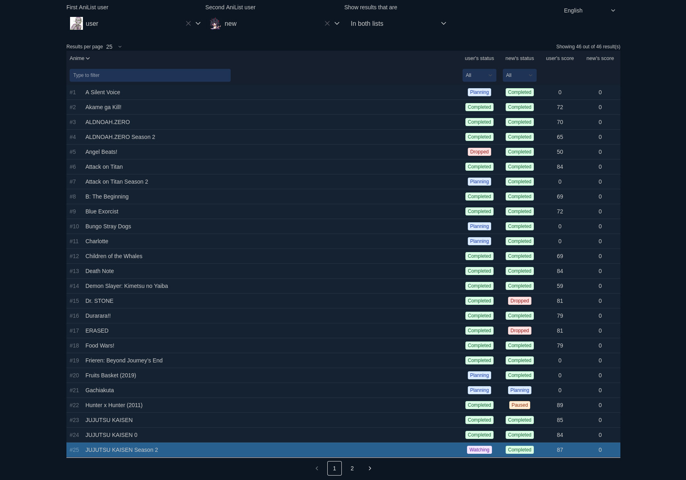

# Unofficial AniList Compare

A React/TypeScript web app for comparing two public AniList anime lists. It integrates with AniList's GraphQL API, and includes tested comparison, filtering, and sorting logic. The app is deployed automatically to GitHub Pages.

[Live demo](https://gmmendezp.github.io/unofficial-anilist-compare/)



## Features

- Search for AniList users with autocomplete and avatar previews.
- Compare two public AniList anime lists side by side.
- Show anime in both lists, either list, or only in one of them.
- Switch between English, romaji, and native titles.
- Filter results by anime title or each user's watch status.
- Sort results by title, watch status, or user score.
- View more details for an anime, including cover art, description, format, genres, and score.

## Tech Stack

- **React + TypeScript**: component-based UI with typed app state and API data.
- **Vite**: local development and production builds.
- **Chakra UI**: accessible UI components and responsive styling.
- **TanStack Query**: AniList API fetching, caching, and request state management.
- **GraphQL Request + GraphQL Code Generator**: typed AniList GraphQL queries.
- **Vitest + Testing Library**: tests for hooks, components, and comparison utilities.
- **GitHub Actions + GitHub Pages**: automated test, build, and deployment workflow.
- **pnpm**: package management.

## Getting Started

Install dependencies and start the dev server:

```sh
pnpm install
pnpm run dev
```

## Scripts

```sh
pnpm run dev
pnpm run build
pnpm run lint
pnpm run test
pnpm run test:watch
pnpm run codegen
pnpm run preview
```

## GraphQL Codegen

The app queries AniList's public GraphQL API and uses generated TypeScript types.

Run codegen after changing GraphQL queries:

```sh
pnpm run codegen
```

## Notes

- This project is not affiliated with AniList.
- It only uses public AniList data.
- Private lists or users that cannot be fetched from the public API cannot be compared.
